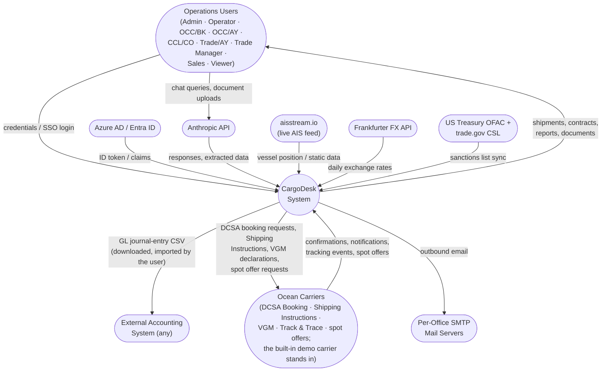
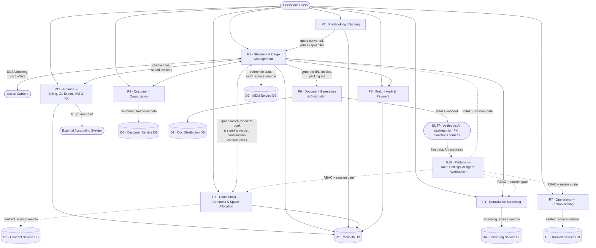

# CargoDesk — Design & Functional Specification (DFS)

**Status**: first pass, top-down; last updated 2026-10-21 (v0.91.10 "Plimsoll" plus the unreleased
work after it — DCSA booking with the built-in demo carrier, booking escalations and lane steering,
the main vessel and Requested-vs-Carrier comparison, SPOT rates and margin rules; §5.12 brought up to
date 2026-10-27 for the DCSA message review: Shipping Instructions and VGM as DCSA, the carrier's local
office on the booking; and 2026-10-28 for the carrier's Master B/L, VGM declarations with their evidence, and
the carrier's events and vessel times; 2026-10-29 for the House B/L audit's rules (§5.9), dangerous goods in
the booking (§5.12) and the shipper's DG emergency contact (§5.8)). **Scope**:
whole application, at the level of its major
functional domains and system-to-system data flows — not an exhaustive per-route specification.
**Companion documents**: [`ARCHITECTURE.md`](ARCHITECTURE.md) (technical architecture, module
maps, per-subsystem implementation detail — the authoritative reference for *how* something is
built), [`CLAUDE.md`](CLAUDE.md) (contributor-facing patterns and conventions). This document
answers a different question than either: *what does the system do, for whom, and how does data
move through it* — the classic Design & Functional Specification pair of concerns, DFDs included.

An offline, self-contained HTML copy (same content, diagrams baked in as static SVG — no network
dependency at all) lives at [`documentation/cargodesk-dfs.html`](documentation/cargodesk-dfs.html)
— open it directly in a browser. It is generated from this file: after changing `DFS.md`, run
`node scripts/build-dfs-html.cjs` to rebuild it (diagrams re-rendered offline). The live artifact
version linked from `documentation/README.md` is an older snapshot.

---

## Table of Contents

1. [Purpose & Audience](#1-purpose--audience)
2. [System Overview](#2-system-overview)
3. [Actors & Roles](#3-actors--roles)
4. [Data Flow Diagrams](#4-data-flow-diagrams)
   - 4.1 [Level 0 — System Context](#41-level-0--system-context)
   - 4.2 [Level 1 — Major Process Decomposition](#42-level-1--major-process-decomposition)
5. [Functional Specification by Domain](#5-functional-specification-by-domain)
6. [Design Specification Summary](#6-design-specification-summary)
7. [Data Stores](#7-data-stores)
8. [Glossary](#8-glossary)

---

## 1. Purpose & Audience

This document specifies CargoDesk's functional scope and data flow, domain by domain, for anyone
who needs to reason about the system without reading its source: onboarding, a design review
before a major change, or an external audit. It is deliberately **top-down** — the first pass
covers every major domain at a consistent level of detail, rather than one domain in exhaustive
depth. Where a domain needs deeper treatment later, that becomes its own Level 2 DFD and
functional appendix, added incrementally.

## 2. System Overview

CargoDesk is a single-tenant freight-forwarding operations system covering the full commercial
lifecycle of a sea-freight shipment: quoting, booking, container/cargo management, operational
accounting, space allocation against carrier contracts, multi-list compliance screening, customs
filing, and an AI assistant over all of it. It runs as one Express monolith plus seven extracted
microservices (§6), each independently toggleable between "local" (monolith-owned data) and
"remote" (its own service) per domain — a deliberate, incremental extraction strategy rather than
a single big-bang rewrite.

## 3. Actors & Roles

| Role | Typical user | Scope |
|---|---|---|
| **admin** | System administrator | Full access, including user management, app settings, secrets |
| **operator** | Day-to-day operations staff | Full shipment/contract/booking read-write, no admin config |
| **occ_bk** | Operations/booking desk | Shipment and booking read-write, narrower than operator on admin-adjacent actions; books as instructed after an escalation; attaches spot offers to shipments |
| **occ_ay** (2026-10-20) | Booking escalation desk, export side | Finds an alternative carrier or sailing for an escalated booking and instructs OCC/BK |
| **ccl_co** (2026-10-20) | Booking escalation desk, import side | The same as OCC/AY, from the shipment's import office |
| **trade_ay** (2026-10-20) | Trade analyst for a lane | Takes escalations OCC/AY or CCL/CO pass up: gives an alternative, marks the booking impossible, or sends it back |
| **trade_manager** | Trade-lane owner | Read-write scoped to their trade lane/office; owns credit-hold override authority; maintains Lane Steering and Margin Rules (with admin) |
| **sales** (v0.91.1) | Quoting/pipeline owner | Read-write on Quotes and Opportunities only; deliberately no booking authority (not granted on shipment/booking/EDI/customs-filing writes) |
| **viewer** | Read-only stakeholder | Read access only, scope-limited the same way as other roles |

A user can hold more than one role; `occ_bk`/`occ_ay`/`ccl_co`/`trade_ay`/`trade_manager`/`sales` are
co-equal, non-hierarchical specialty grants (same rank), not rungs on the admin/operator/viewer ladder. Access is further
scoped by office and/or trade lane (`allOffices`/`userOffices`, `scopeItems`) independent of role —
two `operator`s can see disjoint sets of shipments. Since v0.91.1, office scoping also supports a
**Branch or Country grant** — a single admin action that cascades to every office under it
(inheriting new offices added later), with an optional narrower exclusion carved back out —
instead of only ever assigning one office at a time; this same office-scoping mechanism now also
governs Quotes/Opportunities visibility, which had none before. See `USER-MANAGEMENT-REDESIGN.md`
for the full model and ARCHITECTURE.md §8.9 for the underlying mechanics (JWT, idle-timeout, SSO).

## 4. Data Flow Diagrams

### 4.1 Level 0 — System Context

The whole system as one process, with every genuinely external actor and system around it.

**Reading this diagram**: a circle is a process (here, the whole system as one box); a rounded
rectangle is an external entity — something CargoDesk exchanges data with but does not control.
Every arrow is a real, code-traceable data flow (§6 names the exact call sites); none are
aspirational. The accounting-system flow is the only one a person carries by hand: CargoDesk
produces a generic journal-entry file and the user imports it; there is no live connection to any
specific accounting product (§5.11).

### 4.2 Level 1 — Major Process Decomposition

The system broken into its major functional processes and the data stores behind them. Dashed
arrows mark a **toggle boundary** — five of these processes can run against either the monolith's
own local tables or a standalone microservice, per an `app_settings` flag, with no other code path
change (ARCHITECTURE.md §8.1).

**Reading this diagram**: a rectangle is a process; a cylinder is a data store. `P1`–`P5`, `P7`,
`P8`, `P10`, `P11` are logical processes hosted in the monolith today; five of them (`P3`, `P4`, `P7`,
`P8`, and the MDM lookups every process makes) can be re-pointed at a standalone service and its
own database (`D2`–`D6`) without any other process's code changing — the dashed lines are exactly
that seam. `P9` (document generation) is always split across two real, always-on services
(PDF Render + Document Distribution) regardless of any toggle.

## 5. Functional Specification by Domain

Each domain below: **Purpose**, **Key Functions**, **Roles**, **Primary Data**, and one or two
**Business Rules** worth knowing before touching it. Deep implementation detail lives in
ARCHITECTURE.md §8 (cross-referenced per domain).

### 5.1 Pre-Booking / Quoting & Pipeline (P2)
**Purpose**: capture and price freight demand before a real shipment exists — a two-stage funnel,
an `opportunity` (lead-tracking, pre-pricing) that converts into a `quote` (priced, customer-facing).
**Key functions**: track a lead through New → Qualified → Converted (to Quote)/Lost; create a quote
against a matched contract or spot rate; Draft → Sent → Accepted/Declined/Expired lifecycle;
convert an accepted quote into a real shipment, carrying parties, containers, and cost lines across.
A quote can be **bought on a carrier's spot offer** (§5.13): the quote then takes the offer's carrier
and reference, shows buy / sell / margin, applies the customer's margin rule, and flags a margin under
the rule's minimum. The quote and opportunity lists are filterable the way the Shipments list is: an Excel-style checklist
on each column header, free-text search, sort, and server-side paging (the shared table system,
ARCHITECTURE.md §8.23 — Quotes is its pilot; other lists follow).
**Roles**: operator, occ_bk, sales, admin (write); all roles (read, scope-permitting). `sales`
(v0.91.1) is this domain's dedicated role — owns both objects, no booking authority elsewhere.
**Primary data**: `opportunities`, `quotes`, `quote_lines`; `spot_offers` (a quote's buy side).
**Business rules**: an expired quote cannot be accepted; conversion splits BUY (from the matched
contract, or from the quote's spot offer — a SPOT shipment on the offer's reference) and SELL (from
the quote's own price) cost lines — they are independent figures, not derived from each other. A
quote on a spot offer can't change its carrier, route or contract until the offer is removed. Since v0.91.1 both objects carry an `office_id` and are office-scoped the
same way shipments are (previously neither had any access scoping at all) — the office and any
trade-lane restriction on the acting user's scope both apply. See ARCHITECTURE.md §8.2 and
`USER-MANAGEMENT-REDESIGN.md`.

### 5.2 Shipment & Cargo Management (P1)
**Purpose**: the operational core — everything about moving one shipment from booking to delivery.
**Key functions**: shipment CRUD; multimodal route legs and routing-term derivation; container/
cargo manifest with DG classification; parties (shipper/consignee/principal + flexible additional
roles); milestones; carrier booking lifecycle (DCSA, §5.12); shipment messaging; audit history. A
shipment's vessel, voyage and IMO are its **main** sea leg's (the longest transit), and every place a
sailing is picked or shown marks the main vessel and its feeders (§5.12). A SPOT shipment can carry a
carrier's **spot offer** under its contract (§5.13).
**Roles**: operator, occ_bk (write, scoped by office/trade lane); trade_manager (write within their
lane); viewer (read only).
**Primary data**: `shipments`, `shipment_legs`, `containers`, `shipment_parties`,
`shipment_milestones`, `carrier_bookings`, `shipment_messages`, `shipment_events`.
**Business rules**: a shipment's space badge (Confirmed/Warning/Exceeded) is recomputed on every
container, booking, or allocation-link change — never a stale, on-demand-only calculation.
Cancelling a shipment cascades to cancel its carrier booking (and, on a confirmed spot booking, accrues
the offer's cancellation or no-show fee, §5.13). Since v0.91.7, write authority on a
shipment's own sub-pages is **per-shipment relative to the acting user's office**, not a blanket
role permission: Schedules/Cargo/Carrier Booking/Shipping Instructions are fixed export-side;
Export/Import Services, Customs Filing and Cost Lines gate by the record's own side; an office on
neither side of a given shipment, or an admin/operator, is unrestricted either way. See
ARCHITECTURE.md §8.6, §8.10, §8.12, §8.26.

### 5.3 Commercial — Contracts & Space Allocation (P3 / P3a)
**Purpose**: the commercial terms a shipment books against, and the physical capacity a carrier has
actually committed.
**Key functions**: contract CRUD (legs, rates, routings, container-type/IMDG filters); contract
matching by route/date/routing-term; space configuration — the TEU a carrier has committed on one
contract record (contract number + reference) for a route and period — with conflict detection;
real-time Confirmed/Pending/Rejected consumption tracking against each configuration. When a
shipment's chosen space is full, the contract picker suggests another reference under the same
contract number that fits (checking named account, container types, DG and space, and showing the
freight-rate difference), or lets the user book anyway after confirming an overage reason; how the
space was picked (suggested / direct / overbooked) is recorded on the shipment. The Dashboard's
Contract Consumption view groups consumption per carrier + contract number — a bar per contract,
a six-week confirmed trend, and a breakdown per reference showing confirmed, pending, available and
over-allocated space plus how many bookings followed the steering suggestion — in TEU or % of the
allocation. The contracts list is filterable the way the Shipments list is — a checklist on every
column header, free-text search, sort, an "active as of" date, and server-side paging (the shared
table system, ARCHITECTURE.md §8.23). Schedule Search finds contracts for a lane (POL/POD, carrier-haulage
Pick-up / Delivery points — renamed from "Via Origin / Via Destination", a name kept free for the first / last
transshipment port in a planned contract-routing rework — as-of date, carrier, account, routing term) and lets the user request sailings on any result; its results can be
narrowed by column and sorted (including cheapest-first once a container mix is chosen), in the browser.
The Space Configurations list shows each configuration's trade as an Origin Trade and a Destination Trade
(lanes not stored on an older configuration are worked out from its ports and marked as such), and can be
searched, filtered by carrier / route / trade / contract / status, and sorted by awarded TEU or consumption.
A space configuration holds its TEU **per period** or **per week** (that TEU every Monday-to-Sunday week of
the period, nothing carried over; a shipment counts in the week of its ETD, or of its cargo-ready date until
it has one); weekly ones show their week everywhere, and the Dashboard counts them per week of its dates.
**Where to book**: when a contract is assigned (the shipment form or the Schedules page), CargoDesk shows the
Lane Steering line for the shipment's customer and trade lane, each option as skipped (with the reason), full or
available with its free space in the ETD's week, and pre-selects the first available one (the pick) for the user
to confirm. Choosing a lower option while a higher one has space, a contract off the line, or SPOT asks for a
reason first and is recorded on the shipment as *out of order* / *off the steering* (never blocked); Lane
Steering's Check shows the same answer for a shipment typed in. The Dashboard's **Steering** tab counts, for its
dates, how many shipments followed the steering (the steering rate), by trade lane and carrier, with the ones
that didn't and why.
**Roles**: admin, operator, trade_manager (write); all roles (read).
**Primary data**: `contracts`* , `contract_legs`* , `contract_rates`* , `allocations`, `lane_steerings`, `shipments` (the steering verdict).
*(owned by the Contract Management Service when `contract_source=remote`, monolith-local
otherwise.)*
**Business rules**: every consumption view buckets bookings the same way — *Confirmed* (the
carrier's DCSA confirmation; the operator's own Confirm click was retired on 2026-10-11), *Pending* (no booking yet, created but not
sent, or sent and awaiting the carrier), *Rejected* (shown, never subtracted), *Cancelled* (excluded) — and a shipment counts against
a configuration only through its own link to it, never by matching carrier/route/contract. From
those buckets come two deliberate figures: *Remaining* (allocated − confirmed) is the
configuration's own number; *Available* (allocated − confirmed − pending) is what booking decisions
use — the contract picker and the Dashboard's Contract Consumption — so space already waiting on a
carrier reply isn't sold twice. Disagreement between views has been a recurring, actively hunted bug
class in this codebase. A configuration is unique per contract record, route and period: two
references under one contract number may each hold space on the same lane, which is what makes
steering between them possible. Where to book follows the Steering & Allocation rules: a customer's own
line first, else the line for everyone; a customer's own space is theirs only; the first option with space
is the pick, and a shipment bigger than what's left stays there as an overbooking; with every option full,
the first one takes it. A steered contract with no space configuration counts as order only (no cap). The
verdict is worked out by the server whenever a contract or space is saved, not by the screen. See
ARCHITECTURE.md §8.6, §8.31, §8.32, §8.39.

### 5.4 Compliance Screening (P4 / P4a)
**Purpose**: screen every shipment party and customer against denied-party lists before/while a
shipment proceeds.
**Key functions**: 12-list sanctions screening (OFAC SDN + Consolidated Screening List) across
every party role on a shipment; auto-re-screen on any party change; a company-wide compliance
roll-up view; customs filing (simulated AES/EEI, ISF/AMS).
**Roles**: operator, occ_bk (act on hits); admin (manage screening config); all roles (read status).
**Primary data**: `shipment_screenings`, `sanctions_entries`* , `customs_filings`.
*(owned by the Screening Service when `screening_source=remote`.)*
**Business rules**: a screening hit blocks nothing automatically — it surfaces for manual officer
review and override, logged. See ARCHITECTURE.md §8.4.

### 5.5 Freight Audit & Payment (P5)
**Purpose**: reconcile what a carrier actually invoices against what was contracted and accrued.
**Key functions**: carrier invoice import/matching against contract rates and accrued cost lines
(a spot offer's BUY lines are matched as "vs. spot offer", §5.13);
Detention & Demurrage pre-audit; a Reconcile Carrier Costs modal — the shipment's existing lines
against the contract, charge by charge, with a keep-or-take choice per charge (pre-set to a
suggested choice, or "take all" / "add missing only") — behind Import Contract Costs, Update Carrier
Costs and Reset to Contract. A Central contract's costs are imported automatically, once per
contract, when nothing on the shipment clashes with them; otherwise Cost Entry opens the Reconcile
modal and the user decides (including after a contract swap). Both the invoice list
and the open-exceptions queue are filterable the way the Shipments list is — header checklists, search,
sort, paging (the shared table system, ARCHITECTURE.md §8.23). Since v0.91.8, a **Charge Defaults**
setup (Master Data → Finance) can pre-populate a matching shipment's BUY/SELL cost lines once,
scoped by Principal/Movement Type/Region-Country-Location, so recurring charges never need
re-entering shipment by shipment.
**Roles**: operator, admin, trade_manager (with `canViewFinance`).
**Primary data**: `shipment_cost_lines`, `carrier_invoices`, `charge_default_setups`,
`charge_default_lines`.
**Business rules**: a contract refresh may only ever replace an *accrued* contract or manual BUY
line. Posted, actualized or invoiced lines, Charge Default lines (labelled **CCD**, "Charge Cost
Default"), haulage, carrier-invoice and adjustment lines are never touched — a charge that has one
is shown as locked, and a posted amount is corrected with an adjustment instead. A line the user
deletes after the automatic import stays deleted; bringing it back is a deliberate Import Contract
Costs click. A cost line's `source` must survive a rate refresh correctly, or a dispatcher's manual
correction gets silently destroyed — a real, previously-shipped bug. See ARCHITECTURE.md §8.3,
§8.30. A Charge Default only ever fills a gap: it never overrides a line the shipment already has
from a contract or a manual entry, and it applies at most once per shipment, even if a
better-matching setup is created afterward. See ARCHITECTURE.md §8.27.

### 5.6 Master Data Management (P6a)
**Purpose**: the shared reference data every other domain depends on.
**Key functions**: carriers, vessels, ports (14,269 UN/LOCODEs) with linked-port equivalence, trade
lanes, countries, commodities, charge codes, pack types, carrier line agents (per-port/country
representative resolution), carrier service **loop codes** with a directional (Eastbound/Westbound)
port rotation, and an **HS Codes** registry of real 6-digit Harmonized System codes that cargo
forms pick from instead of typing free text.
**Roles**: admin (write; HS Codes writes also allow operator); every domain (read, as a dependency,
not a direct user-facing action).
**Primary data**: owned by the MDM Service when `mdm_source=remote`, monolith-local otherwise.
Loop Codes (`loop_codes`, `loop_code_ports`) and HS Codes (`hs_codes`) are always monolith-local —
they are not part of the MDM Service's data set.
**Business rules**: port-lane and port-country lookups are hot-path, read on every shipment mapped
— they stay as in-process caches regardless of which mode is active, never a live per-request
fetch. See ARCHITECTURE.md §8.1. A loop's rotation is two independent lists (each stop tagged
Eastbound or Westbound, a port allowed in both) that a shipment header's Loop field resolves and
draws. The HS Codes page can look a classification up live from the EU's public tariff service, but
that result is shown and copied by hand, never stored — the service's terms forbid caching it.
See ARCHITECTURE.md §8.24.

### 5.7 Operations — Kanban / Testing (P7 / P7a)
**Purpose**: internal engineering/ops ticket tracking and manual test-case management, linked to
shipments where relevant.
**Key functions**: a 6-column Kanban board with Epic→Story→sub-task nesting; a separate test-case
repository with test runs; an automated ops-sweep that opens real tickets for detected operational
gaps (e.g. a stale booking).
**Roles**: admin, operator (write); all roles (read).
**Primary data**: owned by the Kanban/Testing Service when `kanban_source=remote`.

### 5.8 Customer / Organization Management (P8 / P8a)
**Purpose**: the counterparties CargoDesk transacts with, and their internal grouping.
**Key functions**: customer CRUD with identifiers/contacts; credit control (AR aging, exposure,
hold/override authority scoped to the trade lane's own trade manager); customer hierarchy
(parent/subsidiary rollup); derived roles (shipper/consignee/etc. computed from actual usage, not
hand-maintained checkboxes). The customer list is filterable the way the Shipments list is — checklists
on company, role and city/country, free-text search, sort, server-side paging — with an All / Trading
Customers / Service Providers switch on top (the shared table system, ARCHITECTURE.md §8.23). A Credit
Overrides queue lists every shipment currently blocked by a credit hold or an over-limit customer, with
the same filtering, search and sort applied in the browser; only the shipment's own lane trade manager
can release or approve. A shipper of dangerous goods carries its own 24-hour **DG emergency contact** on
its profile (2026-10-29): the contact, the 24-hour phone, and optionally its provider (e.g. CHEMTREC) and
its reference number with that provider. It is sent with every dangerous goods booking and printed on
the DG Declaration (DG01); it replaces the org-wide DG Compliance Address, and App Settings no longer has a
Compliance tab. It is entered under Profile → Dangerous goods ("Ships dangerous goods"); a name and a
24-hour phone are needed together, and unticking clears it.
**Roles**: operator, admin (write); trade_manager (credit override, within their lane).
**Primary data**: owned by the Customer/Organization Service when `customer_source=remote`.
**Business rules**: credit-hold/over-limit override authority belongs exclusively to the
shipment's own lane trade manager — not a blanket admin power. See ARCHITECTURE.md §8.1.

### 5.9 Document Generation & Distribution (P9 / P9a / P9b)
**Purpose**: produce and deliver every generated document (B/L, invoices, packing lists, and more)
as a real, tamper-evident signed PDF.
**Key functions**: server-side rendering (headless Chromium) with CAdES/PKCS#7 signing; a
per-office/carrier free-form Document Template Editor (BL01 pilot); outbound delivery via email or
webhook with its own retry/failure handling, decoupled from the request/response cycle that
triggered generation. An issued House B/L (BL01) only moves forward: it is voided with a reason, never
deleted or set back to draft, and a shipment has at most one issued (ARCHITECTURE.md §8.40). Behind it is a
DCSA transport document record: issue is refused until the B/L is complete (parties with addresses, sealed
containers with packages and HS codes, a confirmed booking, loading for a shipped-on-board B/L); release at
destination waits for the originals, paid collect charges and no credit hold (a finance override with a reason);
and the House B/L can be issued and surrendered as an eBL (DCSA eBL Issuance and Surrender 3.0). Its number comes
from the issuing office's series (e.g. RTMHBL2600123), taken when it is issued and never reused, unless one was typed
for a B/L already issued on paper. A correction is a surrender for amendment followed by version 2 under the same
number. The B/L can be issued to order, in a chosen number of originals and copies, with the charges or "freight as
arranged"; it prints every vessel and the on-carriage, a reefer's temperature and dangerous goods. The originals
handed over are logged, and a telex release surrendered at origin sends the import office a task. All of it is run
from the House B/L panel at the top of the shipment's Documents page; Test Tools plays the eBL platform.
**One title to the cargo** (the House B/L audit, 2026-10-29): the originals are logged going out and coming back; an
issued House B/L is voided only by an admin, and never while originals are out, for a live eBL, or after it was
surrendered or the cargo released, and a shipment holding one can't be deleted (it is cancelled instead); no eBL is
issued while paper originals are out; a live eBL is surrendered only on
its platform; a telex release at origin needs every original back. "Shipped on board" needs every container loaded and
is dated by the last, in the port's own date; a received-for-shipment B/L gets a dated on-board notation once all are
aboard. The issuer's legal entity needs a SCAC and address. The House is compared with the carrier's Master (seals,
weights, packages; a warning), the draft can go to the shipper for approval (an answer belongs to the draft it was sent
with), and clauses can be added to it. (The new controls follow the pending mockup; the rules are in place.)
**Roles**: operator, occ_bk (generate/send); all roles (view/download, scope-permitting).
**Primary data**: `shipment_documents`; delivery state owned by the Document Distribution Service.
**Business rules**: PDF Render is stateless by design — no document content is ever persisted
there, only rendered and handed off. See ARCHITECTURE.md §8.1, §12.

### 5.10 Platform (P10)
**Purpose**: the cross-cutting concerns every other domain relies on.
**Key functions**: authentication (JWT + optional Azure AD/Entra SSO) and 9-role RBAC (§3); app-wide
feature toggles; system messages; live FX rates; per-shipment WebSocket subscriptions (not blanket
broadcast); the AI Agent (tool-calling chat + document extraction); GP-by-trade-area reporting
(the finance reports — FX Revaluation, VAT Liability — belong to §5.11).
**Roles**: admin (settings, secrets, user management); all roles (auth, as a precondition for
everything else).
**Primary data**: `users`, `app_settings`, `system_messages`.
**Business rules**: a secret setting (SSO client secret, AI API key, AIS key) is never returned in
plaintext to any role via the generic settings read — a real, previously-shipped vulnerability
class, now closed with a masked-boolean pattern. See ARCHITECTURE.md §8.8, §8.9, §8.13.

### 5.11 Finance — Billing, GL Export, VAT & FX (P11)
**Purpose**: turn a shipment's charges into customer bills, and hand the resulting figures to the
company's accounting and tax processes.
**Key functions**: per-shipment invoices (FR01/FR02) and credit/debit notes (CN01), showing the
supplier's VAT number (per legal entity / branch) and the customer's (from its identifiers), with a
VAT treatment per charge line — standard, zero-rated, reverse-charged or exempt — on both customer
(output VAT) and vendor (input VAT) lines; Mark as Paid, optionally recording the amount received in
the invoice's own currency; **Consolidated Statements** — bill one customer once across several
shipments (draft → confirmed → paid); **GL Export** — a generic journal-entry file built from an
admin-maintained charge code → GL account mapping, picking up only what is new each run, with a
permanent run history; **FX Revaluation** — unrealized and realized exchange gain/loss on non-USD
invoices; **VAT Liability** — output minus input VAT per legal entity for a period, with
zero-rated, reverse-charged and exempt amounts shown separately.
**Roles**: admin, operator (generate statements, run GL exports, mark invoices paid);
trade_manager also maintains GL account mappings; FX Revaluation and VAT Liability need admin or
finance access; the GL Export page is shown to admin, operator or finance access; the Statements
page is shown to every role.
**Primary data**: `shipment_documents`, `shipment_cost_lines`, `customer_statements`,
`customer_statement_lines`, `gl_account_mappings`, `gl_export_batches`; tax numbers on `branches`
and `customer_identifiers`.
**Business rules**: an invoice or credit note counts as *issued* if it was confirmed, or voided by
a proper credit note (the original and its credit note both count and net to zero) — a bare manual
void never counted; every revenue and tax figure uses this one definition. Revenue is recognised
when a billing document is confirmed, cost when a vendor line is posted. A non-standard VAT
treatment always means 0% on the line itself; the three kinds are kept apart because a VAT return
reports them in different boxes. A charge line is billed once: a statement skips lines already on
an issued invoice or another live statement, and an invoice skips lines on a live statement. The gaps
once listed here (statement scope, statements in the GL / VAT / FX figures and reports, VAT on
statements and in GL export, GL-export atomicity, reverse-charge self-assessment) were closed under
Epic TKT-XV4UHD on 2026-09-30; issued invoices can no longer be deleted or un-voided. See
ARCHITECTURE.md §8.28, §8.29, §11 M15.

### 5.12 Carrier Booking — DCSA, Escalations & the Carrier's Changes (P1 / P3)
**Purpose**: get every booking to the carrier in the industry standard, and keep it moving when the
carrier says no, says "yes, but", or says nothing.
**Key functions**: Send Booking Request as a **DCSA Booking 2.0** message — to the carrier's own
integration, or, where it has none, to CargoDesk's built-in **demo carrier** (always on outside
production; in production only when an admin turns it on), which answers like a real carrier and is
marked DEMO CARRIER; only the carrier confirms (no manual confirmation). **Booking escalations**: a
booking the carrier rejects, confirms with changes, or leaves unanswered past the no-answer time can be
escalated by OCC/BK to OCC/AY (export office) or CCL/CO (import office), who find an alternative from
**Lane Steering** (the carrier order per trade lane, for everyone or one customer, with an optional
no-answer switch to the next option; the same order Where to book shows when a contract is assigned, §5.3)
or the contract search, hand it over, or pass it to Trade/AY;
OCC/BK then books as instructed. It all happens in the shipment (Booking & Review) and the Shipments
list's Booking column — no separate section. **The main vessel**: the sea leg with the longest transit
headlines every schedule search and the shipment, and every sailing list marks MAIN and FEEDER legs in
order. **Requested (A) vs Carrier (B)**: Booking & Review compares every detail of what was requested
with the carrier's confirmation (vessel, dates with day deltas, legs, equipment, cut-offs, parties,
the quotation reference and, when the carrier states them, its charges); the user accepts the carrier's
version (legs, dates and cut-offs onto the shipment), asks the carrier to amend, or escalates.
**After the booking** (2026-10-27): the **Shipping Instructions** go to the carrier as DCSA Shipping
Instructions 3.0 once the carrier has confirmed the booking. The carrier receives them, asks for an update
(with its reason; the user corrects them and resends them as an update under the same reference) or
completes them. Each container's **VGM** goes as a DCSA VGM 1.0 declaration when it is marked Submitted. It
is declared again when it changes, and retracted when it goes back to Pending. The carrier's tracking
events arrive as DCSA Track & Trace 3.0.
**The carrier's Master B/L** (2026-10-28): the carrier accepts the Shipping Instructions by drafting its Master
B/L from them. The export side reviews the draft against what was sent: differences first, then the key
facts, with the full field list behind a button. It approves the draft, or corrects the shipment and sends an
update. The carrier issues it (B/L Issued completes), and its surrender for delivery completes the
instructions. An issued House B/L travels in the Master's instructions where the destination's advance
filing needs House-level data (EU ICS2, US AMS, Mercosur).
**Amending the issued Master B/L** (2026-10-28): after the carrier has issued it, a correction to the shipment
(a seal replaced at an inspection, a changed notify party) goes to the carrier as an amendment of the issued
B/L. The user first sees what differs; nothing is sent when nothing does. The carrier declines it (a task, with
its reason) or accepts it: the originals go back (a task until they do) and it issues the amended B/L under the
same number, with the changes on record. Until the carrier works on it, the request can be withdrawn.
**Equipment and seals** (2026-10-28): each container carries its ISO 6346 equipment code (45G1, L5G1…) — the code
the booking, the instructions, the VGM and the B/L send — and 45' containers are allowed (2 TEU). A container
holds several seals, each with who applied it (carrier, shipper, customs, veterinary).
**The carrier's Arrival Notice** (2026-10-28, import side): it lands on the shipment whose Master or House B/L
it names, every version kept. It moves the ETA, fills the containers' empty free days and shows where they
differ (the user keeps theirs or takes the carrier's), and lists the carrier's destination charges, which the
user adds as accruals with one click (one that looks entered starts unticked). AN01 is built from it. The
vessel's berth arrival and departure can also come as DCSA Port Call events; they move the legs' times.
**VGM declarations** are kept, every one, each with its evidence (the weighbridge ticket for Method 1, the
weight calculation for Method 2) and a generated VG01 VGM Declaration. A declaration with no evidence is
flagged.
**The carrier's events** are kept with what CargoDesk did with each. Container events and milestones follow
from them, and the sea legs' times are marked as confirmed by the carrier, its estimate, or AIS (which only
fills in). The carrier's vessel schedules (DCSA OVS 3.0) can be asked for the same.
**Roles**: occ_bk, operator, admin (send, accept, amend, escalate, book as instructed); occ_ay, ccl_co,
trade_ay, trade_manager (escalation steps by side and lane); admin and trade_manager only (Lane
Steering); admin only (the escalation settings).
**Primary data**: `carrier_bookings` (with the carrier's DCSA confirmation), `edi_messages`, `shipping_instructions`,
`transport_documents` (the Master B/L, its amendment), `vgm_declarations`, `carrier_events`, `arrival_notices`,
`port_call_events`, `containers` (ISO code, seals),
`booking_escalations`, `booking_escalation_steps`, `lane_steerings`, `lane_steering_options`,
`dcsa_sim_bookings`.
**Business rules**: a detail DCSA doesn't carry is "Not stated", never "changed". Rebooking elsewhere
replaces the shipment's sea legs from the chosen sailing (feeder, main, feeder). When the carrier,
contract or (for a digital offer) departure changes, it takes the old spot offer off. A rebook to another
carrier drops the old carrier's contract and quote, so instructions for another carrier must name its contract (the booking then goes on that contract number).
- **Contract or quote.** A booking names exactly one contract number or carrier quote reference.
- **Sailing.** A booking names an ETD, or a vessel and voyage.
- **The carrier's local office.** The booking goes to the carrier's local office: the shipment's Line
  Agent (Export).
- **Refusals.** Nothing is sent that isn't valid DCSA, including a field the standard doesn't define;
  the user is told what's missing.
- **No connection.** Shipping Instructions and VGM need a DCSA connection to the carrier (its own, or
  the demo carrier); there is no manual path.
- **What a carrier's push may change** (2026-10-29). A carrier's events, Arrival Notices and port call
  times change only open shipments (never a Completed or Cancelled one), and an event or Arrival Notice
  only that carrier's shipments. The demo carrier's own API answers only CargoDesk. A VGM is Submitted
  to the carrier and isn't "accepted": DCSA VGM has no such answer.
- **Dangerous goods** (2026-10-29). A booking declares its dangerous goods on the equipment line they
  travel in: UN number, proper shipping name, IMO class, weight, packages and the shipper's 24-hour
  emergency contact. A DG container missing any of them, or a shipper with no emergency contact on its
  profile, refuses the booking, saying what's missing. There is no fallback contact.

See ARCHITECTURE.md §8.34–§8.37 and §8.41–§8.44.

### 5.13 Spot Rates & Margins (P2 / P3)
**Purpose**: price a shipment the carrier sells at the day's market rate — what was bought, on which
terms — and the margin a quote adds on top.
**Key functions**: a **spot offer** — the carrier's quotation number or price id, its kind (a *classic
quote*, days to weeks, surcharges often "subject to" at shipment; or a *digital spot* offer such as
Maersk Spot, Hapag-Lloyd Quick Quotes Spot or CMA CGM SpotOn, hours to a day, priced per departure),
route, containers, validity, price-lock point, charges (per container or per B/L, any currency, in the
price or subject to) and penalty terms (cancellation fee and notice, no-show fee, amendment fee, roll
compensation). Offers are typed in, picked from those already entered, or **taken from the carrier**
("Get offers": the carrier's own spot connection, or the demo carrier, answering with one priced offer
per departure; the sailing picker shows the same price per departure on a SPOT shipment). An offer is
attached to a quote (sales) or straight to a shipment (the booking desk, e.g. when the contract has no
space): the shipment becomes SPOT on the offer's reference and its charges become BUY cost lines; the
booking carries the reference to the carrier as DCSA `contractQuotationReference`. **Guardrails**: an
expired digital offer can't be attached or booked; an expired classic quote only warns; cancelling a
confirmed booking shows the fee first and accrues it as a BUY line once the carrier confirms the
cancellation. **Margin Rules** (Master Data): the margin a quote adds — USD per container on the
freight, or a percentage of the buy — by customer, trade lane and container, with a minimum; the most
specific valid rule applies; a quote below the minimum is flagged and recorded when sent, never blocked.
**Roles**: admin, operator, occ_bk, sales (offers, quotes); admin, operator, occ_bk (offers on
shipments, export side); admin and trade_manager only (Margin Rules); all roles (read).
**Primary data**: `spot_offers`, `spot_offer_lines`, `margin_rules`, `dcsa_sim_spot_offers`;
`shipment_cost_lines.spot_offer_id`.
**Business rules**: no DCSA standard covers rates, so each carrier connection is its own adapter
(none live yet: Hapag-Lloyd Quick Quotes and the Maersk Offers API wait on carrier access). Once the
carrier holds the booking (Pending or Confirmed), its offer can't change. Plan and research:
https://claude.ai/artifact/Y61PAmXZfgFxTLtpt7GiAZ. See ARCHITECTURE.md §8.38.

## 6. Design Specification Summary

- **Stack**: React 18 + Vite frontend; Express + Node backend; Postgres (via `pg`, or embedded
  `@electric-sql/pglite` with no `DATABASE_URL`) for every service's own data.
- **Topology**: one monolith (port 3001) + seven independently deployable services — Document
  Distribution (3002), PDF Render (3003), Contract Management (3004), MDM (3005), Screening
  (3006), Kanban/Testing (3007), Customer/Organization (3008).
- **Extraction pattern**: five of the seven follow one repeatable shape — a per-domain
  `app_settings` toggle (`*_source: 'local' | 'remote'`), a CLI migration script to move existing
  data across, and zero code duplication at call sites (a single `getSettings()` branch, not two
  parallel implementations). The other two (PDF Render, Document Distribution) were extracted for
  operational reasons (retry isolation, a heavy bursty operation) and have no local/remote toggle
  — they are always-on, dedicated services.
- **Real-time**: per-shipment WebSocket subscriptions push message/badge/status updates to open
  clients; nothing polls on a fixed interval for data that has a real push path.
- **Security**: JWT (8-hour token) + optional SSO; 9-role RBAC scoped further by office/trade lane;
  secrets are write-only through the API (masked booleans on read).
- **Visual design**: the Dashboard, Command Center and Shipment Details use the "Trade Horizon"
  glass-card design language, which follows the app's dark/light toggle (a dual-theme token set
  swapped in place, ARCHITECTURE.md §4). Other pages use the classic theme. Lists that adopt the
  shared table system (§8.23) behave identically to the Shipments list.
- **Quality gates**: a backend test chain (`npm test`), a frontend Vitest suite and a Cypress suite
  all run in CI against a database that starts empty — every test provisions the reference data it
  needs (e.g. offices) rather than assuming a developer's long-lived local data (ARCHITECTURE.md §10).

Full technical detail (module maps, request lifecycle, ID formats, the complete data model) is in
ARCHITECTURE.md §§2–7 and is intentionally not duplicated here.

## 7. Data Stores

| ID | Store | Owner | Representative tables |
|---|---|---|---|
| D1 | Monolith DB | `server.js` + `routes/*.js` | `spot_offers`, `spot_offer_lines`, `margin_rules`, `booking_escalations`, `lane_steerings`, `dcsa_sim_bookings`, `shipments`, `containers`, `shipment_cost_lines`, `shipment_parties`, `shipment_milestones`, `carrier_bookings`, `quotes`, `allocations`, `shipment_documents`, `customer_statements`, `gl_export_batches`, `users`, `app_settings` |
| D2 | Contract Service DB | `services/contract-management/` | `contracts`, `contract_legs`, `contract_rates`, `contract_routings` |
| D3 | MDM Service DB | `services/mdm/` | `carriers`, `vessels`, `port_locations`, `linked_ports`, `trade_lanes`, `countries`, `commodities`, `carrier_agents` |
| D4 | Screening Service DB | `services/screening/` | `sanctions_entries`, `sanctions_syncs` |
| D5 | Kanban Service DB | `services/kanban/` | `tickets`, `ticket_links`, `test_items`, `kb_projects` |
| D6 | Customer Service DB | `services/customers/` | `customers`, `customer_identifiers`, `customer_contacts`, `customer_screenings` |
| D7 | Doc Distribution DB | `services/document-distribution/` | webhook configs, delivery attempts |

PDF Render (P9a) is stateless and owns no data store.

D1 also holds three master-data registries that are deliberately *not* mirrored into D3: `loop_codes`
and `loop_code_ports` (carrier service loops and their directional rotations) and `hs_codes`
(curated HS-6 classification codes).

## 8. Glossary

| Term | Meaning |
|---|---|
| **DFD** | Data Flow Diagram — the notation used in §4: processes (circles), external entities (rectangles), data stores (cylinders), labeled flows (arrows). |
| **TEU** | Twenty-foot Equivalent Unit — the standard unit for container/space capacity (20ft = 1 TEU, 40ft = 2 TEU, admin-overridable per container type). |
| **EDI** | Electronic Data Interchange — the carrier booking request/response protocol; DCSA is the specific industry-standard EDI schema this app targets for real carrier integrations. |
| **DCSA** | Digital Container Shipping Association — the carriers' interface standards (Booking 2.0, eBL, Track & Trace…). Every CargoDesk booking goes out as DCSA Booking 2.0, Shipping Instructions as DCSA Shipping Instructions 3.0, and each container's VGM as DCSA VGM 1.0; carriers without an integration are played by the built-in demo carrier. |
| **Master B/L** | The carrier's own bill of lading for the shipment, drafted from the Shipping Instructions; CargoDesk reviews and approves the draft, the carrier issues it (§5.12). |
| **VGM evidence / VG01** | What a VGM declaration rests on (weighbridge ticket, weight calculation) and the printable VGM Declaration CargoDesk generates for it. |
| **Line Agent (Export / Import)** | The carrier's local representative at the port of loading (Export) or discharge (Import). A booking is placed with the Line Agent (Export), sent as the DCSA carrier booking office. |
| **Booking escalation** | Handing a rejected, changed or unanswered booking to OCC/AY or CCL/CO (and on to Trade/AY) for an alternative, which OCC/BK then books as instructed (§5.12). |
| **Lane steering** | The carrier order per trade lane (for everyone or one customer), shown as Where to book when a contract is assigned and tried first by escalations (§5.3, §5.12). |
| **Where to book** | The Lane Steering line for a shipment with each option's status and free space, and the pick: the first option with space (§5.3). |
| **Weekly space** | A space configuration holding its TEU every Monday-to-Sunday week of its period, nothing carried over, instead of once for the period (§5.3). |
| **Order only** | A steered contract with no space configuration: it can be booked with no cap. |
| **Out of order / steering rate** | Booking a lower steered option while a higher one has space (recorded with the reason) / the share of shipments that followed the steering, on the Dashboard's Steering tab (§5.3). |
| **Main vessel** | The sea leg with the longest transit in a transshipment; the shipment and every sailing list are headlined by it, feeders marked (§5.12). |
| **Requested (A) vs Carrier (B)** | Booking & Review's detail-by-detail comparison of the booking request with the carrier's confirmation (§5.12). |
| **Spot offer** | A carrier's priced offer for one shipment at the day's market rate: reference, charges, validity, penalty terms (§5.13). |
| **Classic quote / digital spot** | The two kinds of spot offer: a carrier's quote valid days to weeks (expired → a warning) and an instant, per-departure offer valid hours (expired → can't be booked). |
| **Quotation reference** | A spot offer's reference, sent on the booking as DCSA `contractQuotationReference` in place of a contract number. |
| **Subject to** | A charge outside the offered price, billed at its level on the shipment date. |
| **No-show fee** | The penalty for cancelling a confirmed spot booking inside the notice period (otherwise the cancellation fee applies). |
| **Margin rule** | The margin a quote adds on top of what was bought, by customer, lane and container, with a minimum (§5.13). |
| **SDN / CSL** | Specially Designated Nationals (OFAC) / Consolidated Screening List (trade.gov) — the two primary US sanctions/denied-party data sources this app screens against. |
| **B/L** | Bill of Lading — the core transport document; House B/L and Master B/L are both modeled. |
| **INCOTERM** | International Commercial Terms — defines which party bears cost/risk at each point in the shipment's journey. |
| **AIS** | Automatic Identification System — the maritime vessel-tracking protocol this app consumes live via aisstream.io. |
| **RBAC** | Role-Based Access Control — this app's 9-role permission model (§3). |
| **HS Code** | Harmonized System code — the international goods-classification number; the first 6 digits are common worldwide (chapter = the first 2). CargoDesk's registry holds real 6-digit codes; national extensions (e.g. the EU's 8-digit CN) are looked up live, never stored. |
| **Loop code** | A carrier's named recurring service rotation (e.g. `AL1`) — the ordered list of ports one vessel string calls at, out and back. |
| **Eastbound / Westbound (EB / WB)** | The two directional legs of a loop. By convention transatlantic Europe→US is Westbound and transpacific Asia→US is Eastbound; each stop in a loop's rotation carries one of the two. |
| **Contract number / contract reference** | One carrier contract number can have several contract records, each with its own reference (and optionally a named account, validity and rates). Space is committed per record; the Dashboard adds records up per contract number. |
| **Space configuration** | The TEU a carrier has committed on one contract record for a route and period (stored as an `allocation`). |
| **Steering (same-contract suggestion)** | Directing a booking to another reference under the same contract number that still has space, via the contract picker's suggestion; recorded per shipment as suggested / direct / overbooked. Not to be confused with Lane steering. |
| **Remaining / Available** | Remaining = allocated − confirmed; Available = allocated − confirmed − pending. Booking decisions use Available (§5.3). |
| **CCD** | Charge Cost Default — a cost line added automatically from a Charge Defaults setup (Master Data → Finance). |
| **GL / journal entry** | General Ledger — the company's accounting books. A journal entry is a balanced set of debits and credits; GL Export produces them as a file (§5.11). |
| **AR / AP** | Accounts Receivable (owed by customers) / Accounts Payable (owed to vendors) — the two control accounts GL Export posts invoice and cost totals against. |
| **Output / input VAT** | VAT charged to customers on sales / VAT paid to vendors on purchases (normally reclaimable). The VAT owed for a period is output minus input. |
| **Zero-rated / reverse charge / exempt** | Three different reasons a line carries 0% VAT: taxable at 0%; the customer accounts for the VAT instead of the supplier; outside the scope of VAT. Reported separately. |
